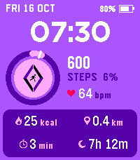
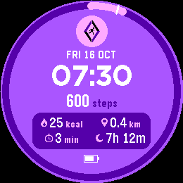
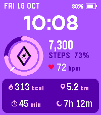
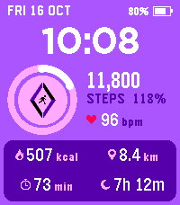
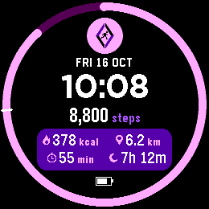

# Facilitate Fitness 2

 

A Pebble watchface for **Pebble Time 2** (emery) and **Pebble Round 2**
(gabbro): a rebuild of Facilitate Fitness, my 2017 step-counter face
([old listing](https://apps.repebble.com/facilitate-fitness_58c17c050dfc32a52a00077a),
aplite and basalt only). It keeps the lavender background, the bold clock and
the pink badge with the two-tone diamond and runner. The badge is redrawn
small and the face now shows everything Pebble Health tracks.

Store: not published yet.

  

## Using it

- **Steps ring:** one lap is your daily goal, filled in pink from 12 o'clock.
  Beat the goal and a second lap starts in white. On the Time 2 the ring
  goes round the badge; on the Round 2 it's the whole bezel.
- **The tick on the ring** is where you'd usually be by now: Pebble Health's
  average for this time of day, on this kind of day (weekday or weekend).
  Pink past the tick means you're ahead of your normal day.
- **Heart rate** (Time 2 only; the Round 2 has no sensor): the latest reading,
  in white when it's under 15 minutes old. An older reading from the last hour
  is shown dimmed rather than blanking to `--`.
- **The card:** active calories, distance walked, active minutes, and sleep
  since 6pm yesterday (so last night counts even if you went to bed before
  midnight).
- **Top:** date and battery (the battery fill turns red at 20%).

## Settings

| Setting | Options | Default |
|---|---|---|
| Theme | Classic (lavender), Midnight (black), Blush (pink) | Classic |
| Daily step goal | My usual day, 5,000 … 20,000 | 10,000 |
| Distance | Same as Pebble Health, kilometres, miles | Same as Pebble Health |

"My usual day" is Pebble Health's average full-day step count for this kind of
day; with no history yet it falls back to 10,000.

## Battery

Redraws once a minute and when Health, battery or settings change. No
animation timers, no accelerometer, no web requests. It reads heart rate but
never changes the sensor's sampling rate. That stays with the watch's own
Health setting (about every 10 minutes when heart-rate monitoring is on).

## How it works

- One canvas layer draws everything from `g_fit` (`src/c/fit.c`), which
  re-reads Pebble Health every minute and on each Health event.
- Layouts: `draw_face()` in `src/c/main.c` has a rectangular version (emery)
  and a round one (gabbro), picked at compile time with `PBL_ROUND`.
- Text is placed by the digits' measured cap height, not the font box, so
  values, units and icons share a baseline across sizes. The numbers come
  from `FF_CALIB=1` + `tools/calib.py`.
- The badge is vector-drawn (`art_logo()` in `src/c/art.c`) in the
  proportions of the 2017 100px bitmap, enlarged now that its caption is gone.
  The icons and runner are one-character-per-pixel strings in the same file.
- Heart rate: `HealthMetricHeartRateBPM` is only kept for 15 minutes, so
  between samples `fit.c` falls back to the newest reading in the last hour of
  minute history.
- Themes (`src/c/theme.c`) use only the watch's 64 colours. Classic is taken
  from the 2017 face: background `AA55FF`, badge `FFAAFF`, diamond `5500AA`.

## Building and testing

```sh
pebble build                                   # emery + gabbro
pebble install --emulator emery
python3 tools/shot.py emery out.png            # QEMU monitor screendump
FF_FAKE=1 FF_SHOW_TIME=1008 tools/snap.sh /tmp/ff emery gabbro   # build + install + shoot
```

Debug flags (environment variables at build time, see `wscript`; never ship a
build with any of them):

| Flag | Effect |
|---|---|
| `FF_SHOW_TIME=1008` | always show 10:08 (the emulator clock can't be set) |
| `FF_FAKE=1` | a fixed, believable day of Health data |
| `FF_PCT=<n>` | with `FF_FAKE`, goal progress in percent (118 shows the second lap) |
| `FF_USUAL=<steps>` | with `FF_FAKE`, where the "usual by now" tick sits |
| `FF_BPM=<n>` | with `FF_FAKE`, the heart rate shown |
| `FF_THEME=<n>` | force a theme: 0 Classic, 1 Midnight, 2 Blush |
| `FF_CALIB=1` | draw each font's "0" for `tools/calib.py` |
| `FF_HR_PERIOD=<s>` | switch the heart-rate sensor on, so the emulator accepts `pebble emu-heart-rate` |

Real Health data in the emulator: `pebble emu-steps 5432`, `emu-distance 3900`,
`emu-calories 250`, `emu-active-time 41`, `emu-sleep 431` (all
`--emulator <platform>`). Heart rate needs an `FF_HR_PERIOD=1` build first,
then `pebble emu-heart-rate 66 --emulator emery`.

## Store assets

```sh
python3 tools/store_assets.py         # all of store/ (needs the emery and gabbro emulators)
python3 tools/store_assets.py --art   # just the icons and banner, from the existing shots
```

It builds each variant with debug flags, installs it, checks the face is
actually on screen (Back and retry if not), and finishes with a clean
`pebble build`. The preview GIF is one day: the ring filling from 07:30 to
21:45, ending on the second lap.

## Publishing

From a clean release build (no `FF_*` flags), first release:

```sh
pebble build
pebble publish --non-interactive --no-gif-all-platforms \
  --name "Facilitate Fitness 2" \
  --description "Your day's fitness at a glance: steps against your goal, heart rate, calories, distance, active minutes and sleep." \
  --icon-small store/icon_80x80.png --icon-large store/icon_144x144.png \
  --release-notes "Facilitate Fitness rebuilt for Pebble Time 2 and Round 2: step goal ring, heart rate, calories, distance, active minutes, sleep and three themes." \
  --screenshots store/emery_*.{gif,png} store/gabbro_*.{gif,png}
```

Then paste the full description from `store/description.md` on the developer
dashboard. Later updates: bump `version` in `package.json` and publish with
just `--release-notes` and `--screenshots`.
